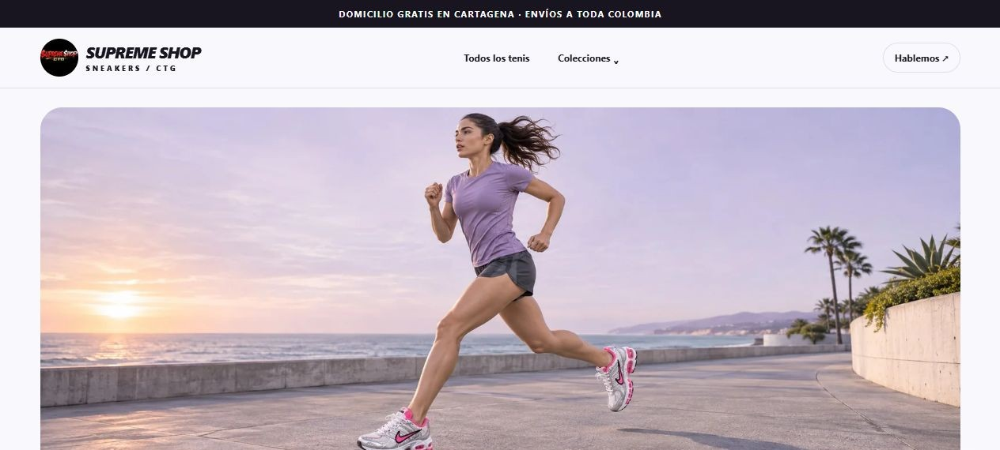

# Supreme Shop CTG

Tienda de tenis para Supreme Shop CTG, Cartagena. Tema a medida para WordPress y WooCommerce, con catálogo por marcas, fotografías de producto estilo estudio y una portada visual adaptable a móviles.

[Ver tienda](https://paleturquoise-llama-938112.hostingersite.com/) · [Ver en el portafolio](https://danielfernandezb.github.io/portafolio-daniel/#supreme-shop)



## Funcionalidades

- Novedades con diez productos: cinco columnas y dos filas en escritorio.
- Búsqueda y filtros por colección, con acceso al catálogo completo.
- Colecciones Adidas, New Balance, Nike, Puma, Mizuno, Asics, Skechers y Exclusivos.
- Fichas con SKU, precio en pesos colombianos, disponibilidad y talla europea.
- Galerías de producto, guía de tallas y contacto por WhatsApp.
- Portada panorámica sin textos y diseño responsive.

## Tecnología y estructura

WordPress, WooCommerce, PHP, CSS y JavaScript sin frameworks de interfaz.

```text
theme/supreme-shop/  Tema instalable, plantillas y recursos
docs/               Captura de la web
scripts/package.ps1 Empaquetado del tema para WordPress
```

`catalog.json` contiene una instantánea inicial de 26 productos. Las imágenes de producto y los recursos visuales del tema se incluyen en `assets/`. El inventario de la tienda publicada se administra en WooCommerce.

## Instalación

1. Instala WordPress y activa WooCommerce.
2. Ejecuta el empaquetado desde PowerShell:

   ```powershell
   ./scripts/package.ps1
   ```

3. Sube `dist/supreme-shop-wordpress.zip` desde **Apariencia → Temas → Añadir tema → Subir tema** y activa Supreme Shop CTG.
4. En una instalación nueva, abre **Apariencia → Supreme Shop** para importar el catálogo inicial por grupos. Una vez completado, gestiona los productos e imágenes desde WooCommerce.
5. Configura las páginas, enlaces permanentes, envíos y datos comerciales de tu instalación.

El repositorio incluye el tema y sus recursos; la base de datos de WordPress, las cuentas de acceso y la configuración del hosting se mantienen en la instalación. La tienda utiliza actualmente un dominio temporal de Hostinger. Las pasarelas de pago requieren configuración independiente.

## Autor

[Daniel Alberto Fernández Botero](https://github.com/danielfernandezb) · [Portafolio](https://danielfernandezb.github.io/portafolio-daniel/)
